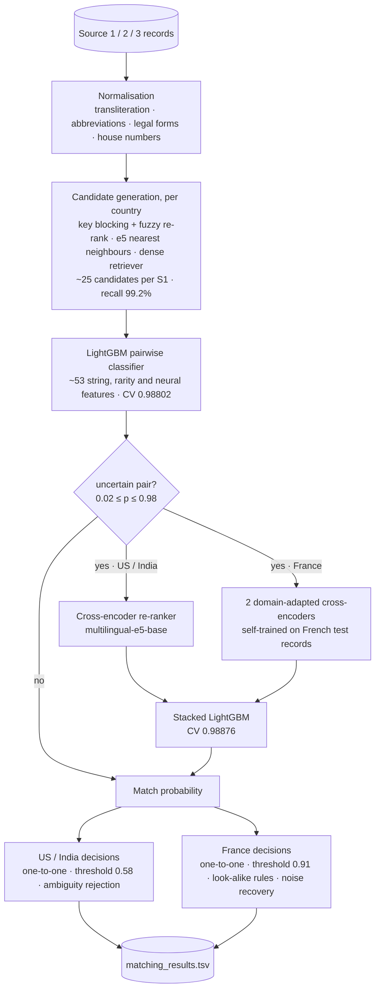

<div align="center">

# Business Entity Resolution at Scale

**Team Amizon · Amazon ML Challenge 2026**

Match every business in Source 1 to all of its noisy copies in Sources 2 and 3,<br>
across 1.7 M test records in three countries, one of them never seen in training.

| Public LB (macro F0.5) | CV, US + India | Candidate recall | Candidates per S1 | External data |
|:---:|:---:|:---:|:---:|:---:|
| **0.986691** | **0.98921** | **99.2 %** | **~25** | **none** |

**[→ Reproduce the output](#1-reproduce-the-output-step-by-step)**

</div>

---

## Contents
1. [Reproduce the output, step by step](#1-reproduce-the-output-step-by-step)
2. [The problem](#2-the-problem)
3. [Solution](#3-solution)
4. [Results](#4-results)
5. [Project structure](#5-project-structure)
6. [Details](#6-details)
7. [Licences and rules](#7-licences-and-rules)

---

## 1. Reproduce the output, step by step

Run the commands from the **package root** (the folder that holds `code/` and `Documentation_template.md`).

**Step 0 · Requirements**
- Linux, macOS or WSL
- a CUDA GPU with 16 GB of memory
- about 40 GB of RAM
- Python 3.12

**Step 1 · Data**

Keep the `student_resource` folder (with `dataset/` and `utils/`) provided by the Amazon anywhere on the machine; its path is
passed to the run command in Step 3.

**Step 2 · Install**
```bash
pip install -r code/business_entity_resolution/requirements.txt
pip install -r code/business_entity_resolution/requirements-gpu.txt   # torch + transformers==4.57.6 (CUDA build)
```

**Step 3 · Run**
```bash
python code/business_entity_resolution/reproduce.py --data /path/to/student_resource
```
The script checks the environment first, runs every stage, and writes `output/matching_results.tsv` and
`output/candidate_pairs.tsv`.

**Step 4 · Validate**
```bash
python utils/validate_submission.py --matching output/matching_results.tsv \
    --candidate output/candidate_pairs.tsv --test-dir dataset/test --check-ids
```

## 2. The problem

| | Train | Test |
|---|---|---|
| Source 1 (reference) records | 2.2 M (US, India) | 1,732,544 (US 38 %, India 47 %, **France 15 %**) |
| Source 2 + 3 records | 10.3 M | 9.97 M |
| Labels | ground truth per S1 | none |

- **Output:** for each S1 record, the S2/S3 records of the same business (empty for singletons).
- **Metric:** F0.5 per S1 record, averaged over all S1 records, singletons included. Precision weighs twice as much as recall.
- **The hard part:** France appears only in test, so everything French has to be learned from unlabelled test records.

What the data showed, and how it shaped the design:

| EDA finding | Design consequence |
|---|---|
| 3.46 true matches per S1, 5.58 % singletons, 74 % of S2/S3 records matched, identical in US and India | the data generator is country-agnostic, so US/India behaviour carries over to France |
| a match never crosses a country | candidates are generated per country |
| names and addresses mix Indic scripts with Latin | transliteration + a dictionary mined from training pairs |
| noise copies swap the last word for *center / services / partners*; decoys add *groupe / holding* at a nearby house number | rarity features, and rules for French look-alikes |
| France has 10–40× more co-located look-alike businesses | France gets its own adapted models and threshold |

## 3. Solution



**Candidate generation.** Records are normalised (Indic scripts transliterated, abbreviations expanded, legal forms
such as Ltd / LLC / SARL removed, house numbers extracted). Per country, IDF-weighted keys on name tokens, consonant
skeletons and address parts give a pool of 1,500 candidates that fuzzy matching re-ranks to 20. Two neural sources add
the records a key would miss: the nearest neighbours of an off-the-shelf `multilingual-e5-small` embedding (top 5) and
of a dense retriever fine-tuned contrastively on training matches (top 10). Result: ~25 candidates per S1 at 99.2 %
recall.

**LightGBM pairwise classifier.** Every candidate pair gets ~53 features: RapidFuzz string similarities, Jaccard and
character TF-IDF cosines, postcode and house-number agreement, name rarity (how many records share the name), blocking
context, the e5 cosine of names and addresses, and the score of a small `multilingual-e5-small` cross-encoder.
LightGBM with Optuna-tuned parameters, 5-fold cross-validation grouped by S1, final model averaged over 3 seeds:
**CV 0.98802**.

**Cross-encoder re-ranker.** Pairs the classifier is unsure about (probability 0.02–0.98, ~1.5 M test pairs) are
re-read by a `multilingual-e5-base` cross-encoder that sees both records together ("name | address" of each). It is
trained twice, once per half of the S1 records, so every training pair is scored by a model that never saw it. A small
stacked LightGBM combines the classifier's score with the cross-encoder's: **CV 0.98876**.

**France: domain-adapted cross-encoders.** France has no labels. We built 885,573 French training pairs from the test
records alone: 300 k pairs the model is at least 99.5 % sure of as positives, and synthetic negatives that copy the data
generator's look-alikes (one generic word swapped, decoy words such as *Groupe* or *Holding* at a nearby house number).
Both re-ranker models are fine-tuned on them for one epoch, and their average replaces the re-ranker for French pairs.

**Decisions.** Each S2/S3 record goes to at most one S1, its highest-scoring one. US/India: threshold 0.58, and a match
is dropped when the runner-up S1 scores ≥ 0.5 within 0.2 of it: **CV 0.98921**. France: threshold 0.91, chosen with a
calibration curve fitted to leaderboard results; a French match is rejected when its name differs from the S1's by one
common word and no other record carries that name (a look-alike business), unless the swapped word is a known noise
word (*Services*, *Associés*, *France*, initials) and both French models are confident. France keeps the model version
without the dense retriever: its extra French candidates were mostly look-alikes and cost France 0.004.

## 4. Results

**Model development** (CV = macro F0.5 on 2.1 M training S1, 5-fold by S1):

| Version | Main change | Recall | CV | Public LB |
|---|---|:---:|:---:|:---:|
| v3 | composite keys, fuzzy re-rank | 93.0 % | 0.9487 | 0.936 |
| v7 | TF-IDF, embeddings, tuned LightGBM, small cross-encoder | 92.6 % | 0.9603 | 0.953 |
| v8 | larger candidate pool, address keys, all training S1 | 96.6 % | 0.9804 | 0.973867 |
| v9 | dictionary, e5 neighbours, rarity features, re-ranker, French rules | 97.8 % | 0.98693 | 0.983893 |
| v10 | dense retriever, 3 seeds, US/India threshold 0.58 | 99.2 % | 0.98921 | 0.985330 |

**Final steps** (each changes only the rows named):

| Step | Public LB | Δ |
|---|:---:|:---:|
| US/India from v10, France from v9 | 0.985926 | +0.000596 |
| + second domain-adapted cross-encoder for France | 0.986050 | +0.000124 |
| France threshold 0.91 | 0.986371 | +0.000321 |
| + French noise-word copies recovered (*Services*, *Associés*) | 0.986525 | +0.000154 |
| + look-alike rule lifted where both French models were confident | 0.986673 | +0.000148 |
| **+ remaining confident cases (final)** | **0.986691** | +0.000018 |

A diagnostic upload with the French rows left empty measured **US/India 0.9897** on the leaderboard (above CV) and
**France 0.9673**. French recall (≈ 0.90) is the remaining gap.

## 5. Project structure

```text
code/business_entity_resolution/
├── reproduce.py            runs the whole pipeline
├── requirements*.txt       pinned dependencies (CPU, GPU)
├── best_params.json        tuned LightGBM parameters
├── native_dict.tsv         native-script word → English word, mined from training pairs
└── src/
    ├── prep.py             normalisation
    ├── blocking.py         key blocking and fuzzy re-rank
    ├── features.py         pair features
    ├── embed.py            e5 similarity features
    ├── ce.py, ce_data.py   cross-encoder training and scoring
    ├── run.py              core driver (candidates, features, training, prediction)
    ├── tune.py             Optuna search for LightGBM
    ├── native_dict.py      builds native_dict.tsv
    └── pipeline/           candidates · extra_features · classifier · rerank · france · decide
```

## 6. Details

<details>
<summary><b>Leakage control</b></summary>

- Cross-validation is grouped by S1 record: all candidates of one S1 stay in one fold.
- The small cross-encoder is trained on 99,948 S1 records that the classifier never trains on.
- The re-ranker's two models each score only the half of the training pairs they did not see; test uses their mean.

</details>

<details>
<summary><b>Tech stack and compute</b></summary>

- Python · Polars · NumPy · RapidFuzz · scikit-learn · SciPy · LightGBM · Optuna · PyTorch · Hugging Face transformers
- `transformers` is pinned to 4.57.6: later versions change cross-encoder scores.
- Used: a 32-core, 54 GB Linux machine (candidate generation peaks at ~36 GB); Kaggle T4 / P100 GPUs.

</details>

<details>
<summary><b>Tried and rejected (measured)</b></summary>

CatBoost blends, a LambdaRank re-ranker, context stacking, word TF-IDF features (France −0.0017 LB), an e5-large
re-ranker (LB −0.0004), a second self-training round for France (LB −0.0002), a learned unseen-country corrector,
row-size thresholds, and removing low-confidence French matches (99 % of them were true).

</details>

## 7. Licences and rules

- Models: LightGBM (MIT), `intfloat/multilingual-e5-small` (118 M) and `-base` (278 M) (MIT), far below the 8 B limit.
- Libraries: MIT, BSD or Apache 2.0.
- No external data, APIs, geocoding or lookups. French adaptation uses only the provided test records, without labels;
  the organisers confirmed this is allowed.
- The competition dataset is not included.
