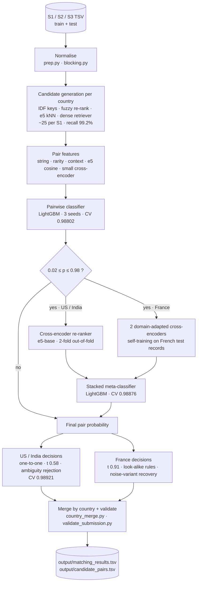

<div align="center">

# Business Entity Resolution at Scale

**Team Amizon · Amazon ML Challenge 2026**

Match every business in Source 1 to all of its noisy copies in Sources 2 and 3,<br>
across 1.7 M test records in three countries, one of them never seen in training.

| Public LB (macro F0.5) | CV, US + India | Candidate recall | Candidates per S1 | External data |
|:---:|:---:|:---:|:---:|:---:|
| **0.986691** | **0.98921** | **99.2 %** | **~25** | **none** |

</div>

---

## Contents
1. [The problem](#1-the-problem)
2. [Approach](#2-approach)
3. [Project structure](#3-project-structure)
4. [Pipeline](#4-pipeline)
5. [Results](#5-results)
6. [Key technical details](#6-key-technical-details)
7. [Reproduce the output, step by step](#7-reproduce-the-output-step-by-step)
8. [Licences and rules](#8-licences-and-rules)

---

## 1. The problem

| | Train | Test |
|---|---|---|
| Source 1 (reference) records | 2.2 M (US, India) | 1,732,544 (US 38 %, India 47 %, **France 15 %**) |
| Source 2 + 3 records | 10.3 M | 9.97 M |
| Labels | ground truth per S1 | none |

- **Output:** for each S1 record, the list of S2/S3 records of the same business (empty for singletons).
- **Metric:** F0.5 per S1 record, averaged over all S1 records, singletons included. Precision weighs twice as much as recall.
- **The hard part:** France appears only in test. All French knowledge has to come from the unlabelled test records.

What the data showed, and how it shaped the design:

| EDA finding | Design consequence |
|---|---|
| 3.46 true matches per S1, 5.58 % singletons, 74 % of S2/S3 records matched, identical in US and India | the data generator is country-agnostic, so US/India behaviour carries over to France |
| a match never crosses a country | blocking runs per country |
| names and addresses mix Indic scripts with Latin | stdlib transliteration + a dictionary mined from training pairs |
| noise copies swap the last word for *center / services / partners*; decoys add *groupe / holding* at a nearby house number | rarity and look-alike features, and French decision rules |
| France has 10–40× more co-located look-alike businesses | France gets its own adapted models and thresholds |

## 2. Approach

A **two-stage matcher** on a **high-recall candidate set**, followed by a **per-country decision layer**:

1. **Normalise** every record: transliteration, abbreviations, legal forms, house-number keys.
2. **Generate candidates** per country: IDF key blocking, fuzzy re-rank, and dense retrieval give ~25 candidates per S1 at 99.2 % recall.
3. **Score every pair** with a LightGBM classifier over ~53 string, rarity, context and neural features.
4. **Re-rank uncertain pairs** (probability 0.02–0.98) with a multilingual cross-encoder, combined by a stacked meta-classifier.
   For France, the cross-encoder is replaced by two **domain-adapted** copies trained by self-training on French test records.
5. **Decide** per country: one-to-one assignment, ambiguity rejection, a calibrated threshold, French look-alike rules.
6. **Merge by country:** US/India rows from the v10 build, French rows from the v9 build (fewer French look-alike candidates).

## 3. Project structure

```text
.
├── README.md                          ← this file
├── Documentation_template.md          ← methodology write-up (competition template)
├── output/                            ← only in the submission zip, not in the git repository
│   ├── matching_results.tsv           ← final matches (= the leaderboard upload, LB 0.986691)
│   └── candidate_pairs.tsv            ← the pairs the model scored (~25 per S1)
└── code/business_entity_resolution/
    ├── README.md                      ← same file as this one
    ├── requirements.txt               ← pinned CPU stack (polars, lightgbm, rapidfuzz, scikit-learn, scipy …)
    ├── requirements-gpu.txt           ← torch + transformers==4.57.6 for the GPU steps
    ├── best_params.json               ← Optuna-tuned LightGBM parameters
    ├── native_dict.tsv                ← native-script word → English word (5,484 entries, mined from train pairs)
    └── src/
        ├── prep.py                    ← normalisation: transliteration, abbreviations, legal forms, skeletons, house keys
        ├── native_dict.py             ← mines native_dict.tsv from training match pairs
        ├── blocking.py                ← TSV → parquet; per-country key join, IDF pool, fuzzy re-rank, top-k
        ├── features.py                ← rapidfuzz / Jaccard / postcode / house-number / char TF-IDF / context features
        ├── embed.py                   ← GPU: e5-small cosine of names and addresses per pair
        ├── ce_data.py                 ← builds cross-encoder training pairs (S1 kept out of the classifier's CV)
        ├── ce.py                      ← GPU: fine-tunes or applies a cross-encoder (e5-small or e5-base)
        ├── tune.py                    ← Optuna search for LightGBM → best_params.json
        ├── run.py                     ← pipeline driver: stages pairs, train, predict, all
        └── experiments/
            │   ── candidates ──
            ├── n4_search.py           ← GPU (Kaggle): e5 nearest neighbours per S1, a candidate source
            ├── ret_train.py           ← GPU (Kaggle): contrastive fine-tune of the dense retriever
            ├── ret_search.py          ← GPU (Kaggle): retriever top-k neighbours, a candidate source
            │   ── features and classifier ──
            ├── rarity_cols.py         ← name-rarity counts per pair
            ├── tfw_cols.py            ← word TF-IDF cosines (v9 only; dropped in v10)
            ├── retrain_extra.py       ← LightGBM: 5-fold GroupKFold OOF, threshold search, multi-seed final fit
            │   ── re-ranking and French adaptation ──
            ├── band_export.py         ← exports the uncertainty-band pairs for the cross-encoder
            ├── ce2_band.py            ← stacked meta-classifier on [classifier logit, cross-encoder logit]
            ├── fr_synth.py            ← builds the French self-training set (pseudo-labels + synthetic negatives)
            ├── cpu_score.py           ← scores pairs with a trained cross-encoder on CPU
            ├── kaggle/                ← GPU job wrappers (frce_train.py, ce2_train_h0.py, band_score_h0.py, ce3_*.py)
            │   ── decision layer ──
            ├── country_threshold.py   ← one-to-one assignment, per-country thresholds, ambiguity rejection
            ├── country_thr_cv.py      ← picks the US/India threshold and ambiguity δ on the stage-2 OOF
            ├── france_rule.py         ← lists French look-alike pairs (rules P1 / P2′)
            ├── france_probe.py        ← applies a pair list to a submission (reject or accept), French rows only
            ├── france_noise_accept.py ← noise-variant recovery + high-confidence rule reversal (final step)
            ├── france_thr_model.py    ← fits the France calibration curve from leaderboard steps
            ├── country_merge.py       ← merges two submissions by country
            ├── final_assemble.sh      ← thresholds + French rules + validator in one command
            │   ── research, not needed to reproduce ──
            └── rule_sim.py, probe1_sim.py, corrector_sim.py, proxy_mine.py, proxy_cache.py,
                swap_asymmetry.py, twin_groups.py, frce_probe.py, france_rescue.py
```

## 4. Pipeline



| # | Stage | Input → output | Scripts |
|---|---|---|---|
| 1 | Normalise | raw TSV → normalised parquet (`work*/{split}_s1`, `_cand`) | `prep.py`, `blocking.py` |
| 2 | Candidates | normalised records → pair list (`*_pairs_*.parquet`) | `run.py pairs`, `n4_search.py`, `ret_*.py` |
| 3 | Features | pairs → feature table | `features.py`, `rarity_cols.py`, `embed.py`, `ce.py` |
| 4 | Classifier | features → probability per pair (OOF + test) | `retrain_extra.py` |
| 5 | Re-rank + stack | band pairs → re-scored probability | `band_export.py`, `ce.py`, `ce2_band.py` |
| 6 | French adaptation | French test records → adapted cross-encoders | `fr_synth.py`, `ce.py`, `kaggle/frce_train.py` |
| 7 | Decisions | probabilities → matches per country | `final_assemble.sh`, `country_threshold.py`, `france_rule.py`, `france_probe.py` |
| 8 | Merge + recover | two submissions → final file | `country_merge.py`, `france_noise_accept.py` |

## 5. Results

**Model development** (CV = macro F0.5 on 2.1 M training S1, 5-fold by S1):

| Version | Main change | Recall | CV | Public LB |
|---|---|:---:|:---:|:---:|
| v3 | composite keys, fuzzy re-rank | 93.0 % | 0.9487 | 0.936 |
| v7 | TF-IDF, embeddings, tuned LightGBM, cross-encoder | 92.6 % | 0.9603 | 0.953 |
| v8 | larger pool, address keys, all training S1 | 96.6 % | 0.9804 | 0.973867 |
| v9 + re-ranker + French rules | dictionary, rescue, neighbours, rarity | 97.8 % | 0.98693 | 0.983893 |
| v10 + US/India threshold 0.58 | dense retriever top 10, 3 seeds | 99.2 % | 0.98921 | 0.985330 |

**Final day** (each step changes only the rows named):

| Step | Public LB | Δ |
|---|:---:|:---:|
| US/India from v10, France from v9 (country merge) | 0.985926 | +0.000596 |
| + second domain-adapted cross-encoder for France | 0.986050 | +0.000124 |
| France threshold 0.91 (calibration curve over 8 LB points) | 0.986371 | +0.000321 |
| + French noise variants recovered (*Services*, *Associés*) | 0.986525 | +0.000154 |
| + look-alike rule reversed where both French models were confident | 0.986673 | +0.000148 |
| **+ remaining high-confidence reversals (final)** | **0.986691** | +0.000018 |

**Where the score stands:** a diagnostic upload with the French rows emptied measured **US/India 0.9897** on the
leaderboard (above CV) and **France 0.9673**. French recall (≈ 0.90) is the remaining gap.

## 6. Key technical details

<details open>
<summary><b>Models</b></summary>

| Model | Base | Trained on | Role |
|---|---|---|---|
| Dense retriever | `multilingual-e5-small` (MIT, 118 M), contrastive fine-tune | train S1 ↔ matched records | candidate source (top 10) |
| Small cross-encoder | `multilingual-e5-small` | 2.94 M pairs of 99,948 S1 kept out of the classifier's CV | pair feature |
| Pairwise classifier | LightGBM, Optuna-tuned | 55 M training pairs | probability for every pair |
| Cross-encoder re-ranker | `multilingual-e5-base` (MIT, 278 M), 2-fold out-of-fold | band pairs of each S1 half | re-scores uncertain pairs |
| Stacked meta-classifier | LightGBM, 200 trees, 15 leaves | band pairs (OOF) | [classifier logit, re-ranker logit] → probability |
| Domain-adapted cross-encoders A / B | re-ranker folds 0 / 1, fine-tuned 1 epoch, lr 2e-5 | 885,573 French pairs from test records: 300 k confident positives, synthetic sibling and decoy negatives | replace the re-ranker for French pairs, averaged |
| France calibration curve | logistic, 2 parameters | 8 leaderboard steps | chooses the France threshold |

</details>

<details>
<summary><b>Leakage control</b></summary>

- CV is 5-fold **GroupKFold by S1 record**: all candidates of one S1 stay in one fold.
- The small cross-encoder is trained on 99,948 S1 records; `--exclude-s1` removes exactly those S1 from the classifier's training rows.
- The re-ranker is trained 2-fold: each half's model scores only the other half's training pairs; test uses the mean of both.
- `run.py` stops if any pair lacks a GPU score; `ce2_band.py` asserts full band coverage.

</details>

<details>
<summary><b>Decision layer</b></summary>

- **One-to-one assignment:** each S2/S3 record goes to at most one S1, its highest-scoring one.
- **Ambiguity rejection (US/India):** drop a match when the runner-up S1 scores ≥ 0.5 within 0.2 of it (+0.00018 CV).
- **Thresholds:** US/India 0.58 (CV optimum with ambiguity rejection, flat from 0.56 to 0.62); France 0.91 (calibrated on the leaderboard).
- **French look-alike rules:** reject pairs whose names differ by one common word, at the same address (P1) or a different address (P2′).
- **Noise-variant recovery:** re-accept pairs the rules removed when the swapped word is a generator noise word (*Services*, *Associés*, *France*, initials) and both French models score ≥ 0.91.

</details>

<details>
<summary><b>Tech stack and compute</b></summary>

- Python 3.12 · Polars (streaming parquet) · NumPy · RapidFuzz · scikit-learn · SciPy · LightGBM · Optuna
- PyTorch + Hugging Face transformers **4.57.6** (pinned: 5.x changes cross-encoder logits)
- CPU: Linux / WSL2, 32 cores, 54 GB RAM (blocking peaks at ~36 GB)
- GPU: Kaggle 2×T4 and P100 notebooks, one RTX 3050 laptop for scoring

</details>

<details>
<summary><b>Tried and rejected (measured)</b></summary>

CatBoost blends, a LambdaRank re-ranker, context stacking, word TF-IDF in the final (France −0.0017 LB), an e5-large
re-ranker (LB −0.0004), a second self-training round for France (LB −0.0002), a learned unseen-country corrector,
row-aware thresholds, and removing low-confidence French tails (99 % of the removed pairs were true matches).

</details>

## 7. Reproduce the output, step by step

> Run every command from the **package root**: the folder that holds `code/` and `Documentation_template.md`.
> Steps marked **GPU** need CUDA; we ran them as Kaggle notebooks (wrappers in `src/experiments/kaggle/`).
> Intermediate files are cached in `work/`, `work9/`, `work10/`. Delete a file to force its rebuild.

### Step 0 · Environment

```bash
# 0.1 link the competition data and the organisers' validator into the package root
ln -s /path/to/student_resource/dataset dataset
ln -s /path/to/student_resource/utils   utils
# 0.2 the helper scripts are called as experiments/… (in the package they live under src/experiments)
ln -s code/business_entity_resolution/src/experiments experiments
# 0.3 Python environment
python3 -m venv .venv
.venv/bin/pip install -r code/business_entity_resolution/requirements.txt
.venv/bin/pip install -r code/business_entity_resolution/requirements-gpu.txt   # GPU steps only (+ a CUDA build of torch)
# 0.4 shortcuts used below
S=code/business_entity_resolution/src
X=experiments
P=code/business_entity_resolution/best_params.json
# 0.5 self-test of the normaliser (prints "ok")
.venv/bin/python $S/prep.py
```

### Step 1 · Shared inputs: raw text, neighbours, small cross-encoder

```bash
# 1.1 normalised records (base blocking) and raw text per record for the GPU scripts
.venv/bin/python $S/run.py pairs --work work --n-train 2206821 --k-use 20 --pool 1500 --addr-partial --addr-keys
mkdir -p work/text && .venv/bin/python -c "import polars as pl
for s in ('train','test'):
    for w in ('s1','cand'):
        pl.scan_parquet(f'work/{s}_{w}/*.parquet').select('idx','business_name','business_address').sink_parquet(f'work/text/{s}_{w}.parquet')"
# 1.2 small cross-encoder: training set of S1 kept out of the classifier, then GPU fine-tune
.venv/bin/python $S/ce_data.py --n-train 600000 --out work/ce
.venv/bin/python $S/ce.py --text work/text --pairs work/ce --out work/gpu                        # GPU
```

GPU · Kaggle notebooks for the two neighbour sources (attach `work/text` and the `work/*_pairs` files as a dataset):

| Notebook | Produces | Notes |
|---|---|---|
| `experiments/n4_search.py` | `work/n4/{train,test}_knn.parquet` | set `SPLIT` to `train`, then `test` |
| `experiments/ret_train.py` | fine-tuned retriever model | trains on the 99,948 held-out S1 only |
| `experiments/ret_search.py` | `work/ret/{train,test}_knn.parquet` | uses the retriever model; set `SPLIT` |

### Step 2 · Build v9 (source of the French rows)

```bash
FLAGS9="--work work9 --n-train 2206821 --k-use 20 --pool 1500 --addr-partial --addr-keys --rescue \
        --knn work/n4 --knn-top 5 --rare-empty --exclude-s1 work/ce/ce_train.parquet"
.venv/bin/python $S/run.py pairs $FLAGS9                                  # candidates + work9/emb_in for the GPU
.venv/bin/python $X/tfw_cols.py    --work work9 --tag k30_p1500_ap_ak_use20_rs_knn5_re
.venv/bin/python $X/rarity_cols.py --work work9 --tag k30_p1500_ap_ak_use20_rs_knn5_re
.venv/bin/python $S/run.py train   $FLAGS9 --features-only
.venv/bin/python $S/run.py predict $FLAGS9 --features-only
# GPU · neural pair features for every candidate pair
mkdir -p work9/text work9/gpu && .venv/bin/python -c "import polars as pl
for s in ('train','test'):
    for w in ('s1','cand'):
        pl.scan_parquet(f'work9/{s}_{w}/*.parquet').select('idx','business_name','business_address').sink_parquet(f'work9/text/{s}_{w}.parquet')"
.venv/bin/python $S/embed.py --text work9/text --pairs work9/emb_in --out work9/gpu
.venv/bin/python $S/ce.py    --text work9/text --pairs work9/emb_in --out work9/gpu --model-dir work/gpu/ce_model
# classifier: 5-fold OOF + threshold + final fit
.venv/bin/python $X/retrain_extra.py --work work9 --params $P \
    --extra 'work9/gpu/{split}_emb.parquet' --extra 'work9/gpu/{split}_ce.parquet' \
    --extra 'work9/tfw_{split}.parquet' --extra 'work9/rarity_{split}.parquet' --out output_v9 --tag v9
```

### Step 3 · Cross-encoder re-ranker on v9's uncertain band

```bash
# GPU · e5-base re-ranker, one model per S1 half (Kaggle wrapper: $X/kaggle/ce2_train_h0.py, h1 alike)
for h in 0 1; do
  .venv/bin/python $S/ce_data.py --half $h --n-ce 200000 --k-use 20 --out work/ce2
  .venv/bin/python $S/ce.py --text work/text --pairs work/ce2 --train-file ce_train_h$h.parquet --out work/ce2_h$h \
      --model intfloat/multilingual-e5-base --lr 3e-5 --epochs 1 --batch 64
done
# export the band (0.02 <= p <= 0.98) and score it with both models (GPU)
.venv/bin/python $X/band_export.py --oof work9/oof_v9.parquet --test-prob work9/test_prob_v9.parquet --out work9/band
for h in 0 1; do
  .venv/bin/python $S/ce.py --text work9/text --pairs work9/band/h$h --out work9/ce2band/h$h --model-dir work/ce2_h$h/ce_model
done
# stacked meta-classifier -> work9/test_prob_v9ce2.parquet
.venv/bin/python $X/ce2_band.py --work work9 --band work9/ce2band --oof work9/oof_v9.parquet \
    --test-prob work9/test_prob_v9.parquet --meta work9/tune_meta.parquet --report work9/report_v9.json \
    --src output_v9 --out output_v9ce2
# French look-alike rule lists: P1 (same address), P2' (different address)
.venv/bin/python $X/france_rule.py --work work9 --pairs work9/test_prob_v9ce2.parquet --out work9/g_test_common.parquet
.venv/bin/python $X/france_rule.py --work work9 --pairs work9/test_prob_v9ce2.parquet --address different \
    --out work9/g2_test_diffaddr_sym.parquet
```

### Step 4 · Domain-adapted French cross-encoders

```bash
# 4.1 French self-training set from the TEST records (no labels): confident positives + synthetic negatives
.venv/bin/python $X/fr_synth.py --out work9/frce --score work9/test_prob_v9ce2.parquet
# 4.2 GPU · model A = re-ranker half 0, fine-tuned on it; scores the French pairs -> work9/frce_out/test_ce.parquet
.venv/bin/python $S/ce.py --text work9/frce/text --pairs work9/frce/pairs --out work9/frce_out \
    --model work/ce2_h0/ce_model --lr 2e-5 --epochs 1 --batch 64
# 4.3 GPU · model B = the same recipe from half 1                                 -> work10/frce_b/test_ce.parquet
.venv/bin/python $S/ce.py --text work9/frce/text --pairs work9/frce/pairs --out work10/frce_b \
    --model work/ce2_h1/ce_model --lr 2e-5 --epochs 1 --batch 64
# 4.4 GPU · e5-large helper ensemble: 4 shards ($X/kaggle/ce3_shard.py), mean of the shard logits
#     -> work9/ce3ens/{train,test}_ce.parquet. Step 6.2 uses it only to fit the stacking model on S1 half 1,
#     exactly as the uploaded file was built; its scores are not a model input there.
```

### Step 5 · Build v10 (source of the US/India rows)

```bash
FLAGS10="--work work10 --n-train 2206821 --k-use 20 --pool 1500 --addr-partial --addr-keys --rescue --knn work/n4 \
         --knn-top 5 --knn2 work/ret --knn2-top 10 --rare-empty --exclude-s1 work/ce/ce_train.parquet --tfidf-all"
.venv/bin/python $S/run.py pairs $FLAGS10
.venv/bin/python $X/rarity_cols.py --work work10 --tag k30_p1500_ap_ak_use20_rs_knn5_rk10_re
.venv/bin/python $S/run.py train   $FLAGS10 --features-only
.venv/bin/python $S/run.py predict $FLAGS10 --features-only
# GPU · neural pair features: the step-2 text export, embed.py and ce.py commands with work9 replaced by work10
.venv/bin/python $X/retrain_extra.py --work work10 --params $P \
    --extra 'work10/gpu/{split}_emb.parquet' --extra 'work10/gpu/{split}_ce.parquet' --extra 'work10/rarity_{split}.parquet' \
    --seeds 3 --out output_v10 --tag v10                                   # CV 0.98802
# re-ranker band for v10: band_export + GPU scoring as in step 3, into work10/band/h0 and h1, then stacking
.venv/bin/python $X/band_export.py --oof work10/oof_v10.parquet --test-prob work10/test_prob_v10.parquet --out work10/band
.venv/bin/python $X/ce2_band.py --work work10 --band work10/band --oof work10/oof_v10.parquet \
    --test-prob work10/test_prob_v10.parquet --meta work10/tune_meta.parquet --src output_v10 --out output_v10ce2
# rule lists with v9's normalisation over v10's pairs (the lists the leaderboard probes validated)
.venv/bin/python $X/france_rule.py --work work9 --pairs work10/test_prob_v10.parquet --out work10/g_test_common_w9prep.parquet
.venv/bin/python $X/france_rule.py --work work9 --pairs work10/test_prob_v10.parquet --address different \
    --out work10/g2_test_diffaddr_sym_w9prep.parquet
```

### Step 6 · Decisions, merge, final file

```bash
# 6.1 US/India rows: threshold 0.58 + ambiguity rejection (this file's French rows are replaced in 6.3)
T=0.58 G1=work10/g_test_common_w9prep.parquet G2=work10/g2_test_diffaddr_sym_w9prep.parquet \
  bash $X/final_assemble.sh work10 work10/test_prob_v10ce2.parquet output_v10ce2/ce2_band.json output_final_v11L1 0.10
# 6.2 French rows: v9 stacking with French models A + B averaged; France threshold 0.72 + 0.19 = 0.91
.venv/bin/python $X/ce2_band.py --work work9 --band work9/ce2band --oof work9/oof_v9.parquet \
    --test-prob work9/test_prob_v9.parquet --meta work9/tune_meta.parquet --report work9/report_v9.json \
    --src output_v9 --out output_v9ce3ab_control_p5b --save-test-prob work9/test_prob_v9_p5b.parquet \
    --ce3 work9/ce3ens --frce work9/frce_out work10/frce_b --frce-min-cov 0.95 --write-arm control --margin -1
bash $X/final_assemble.sh work9 work9/test_prob_v9_p5b.parquet output_v9ce3ab_control_p5b/ce2_band.json \
  output_final_v9_p5b_fr0.19 0.19
# 6.3 merge by country: US/India rows from 6.1, French rows from 6.2                    (LB 0.986371)
.venv/bin/python $X/country_merge.py --base output_final_v11L1 --take output_final_v9_p5b_fr0.19 \
    --countries France --out output_probe_hyb2_p5b_frt0.19
# 6.4 French noise-variant recovery + high-confidence rule reversal -> output/          (LB 0.986691)
.venv/bin/python $X/france_noise_accept.py --base output_probe_hyb2_p5b_frt0.19 --reverse-rules --out output
```

### Step 7 · Validate

```bash
python3 utils/validate_submission.py --matching output/matching_results.tsv \
    --candidate output/candidate_pairs.tsv --test-dir dataset/test --check-ids
# expected: 1,732,544 rows in each file, 5,817,951 matches, "PASS — no blocking issues found"
```

> **Exactness.** Steps 6.3–6.4 rebuild the uploaded file with identical match and candidate sets on every row from the
> step-6.1 and 6.2 files. The uploaded run scored French pairs selected from both an earlier v8.1 build and v9
> (`fr_synth.py --score …v81ce2 --score …v9ce2`), plus 210,562 extra French pairs scored on CPU with `cpu_score.py`;
> Step 4.1 selects from v9 only: it covers 95.2 % of the French pairs step 6.2 re-scores (the uploaded run: 95.7 %;
> the check needs 95 %). The ~5,800 pairs in between keep their stage-2 probability, so a handful of French rows can
> differ from the upload. Cross-encoder scores can also differ in the last decimals across GPU types; keep
> `transformers==4.57.6`.

## 8. Licences and rules

- Models: LightGBM (MIT) and `intfloat/multilingual-e5-small` / `-base` / `-large` (MIT), all far below the 8 B parameter limit.
- Libraries: Polars, RapidFuzz, scikit-learn, SciPy, NumPy, Optuna (MIT / BSD / Apache 2.0).
- No external data, APIs, geocoding or lookups. French adaptation uses only the provided test records, without labels
  (self-training and synthetic pairs, confirmed as allowed by the organisers).
- The competition dataset is not included.
