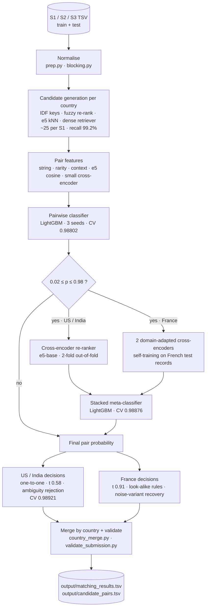

<div align="center">

# Business Entity Resolution at Scale

**Team Amizon · Amazon ML Challenge 2026**

Match every business in Source 1 to all of its noisy copies in Sources 2 and 3,<br>
across 1.7 M test records in three countries, one of them never seen in training.

| Public LB (macro F0.5) | CV, US + India | Candidate recall | Candidates per S1 | External data |
|:---:|:---:|:---:|:---:|:---:|
| **0.986691** | **0.98921** | **99.2 %** | **~25** | **none** |

**[→ Reproduce the output](#1-reproduce-the-output-step-by-step)**

</div>

---

## Contents
1. [Reproduce the output, step by step](#1-reproduce-the-output-step-by-step)
2. [The problem](#2-the-problem)
3. [Approach](#3-approach)
4. [Project structure](#4-project-structure)
5. [Pipeline](#5-pipeline)
6. [Results](#6-results)
7. [Key technical details](#7-key-technical-details)
8. [Licences and rules](#8-licences-and-rules)

---

## 1. Reproduce the output, step by step

The whole pipeline runs from **one script**. Run everything from the **package root**, the folder that holds `code/`
and `Documentation_template.md`.

**Step 1 · Put the data and the validator next to `code/`**
```bash
ln -s /path/to/student_resource/dataset dataset
ln -s /path/to/student_resource/utils   utils
```

**Step 2 · Install**
```bash
python3 -m venv .venv && source .venv/bin/activate
pip install -r code/business_entity_resolution/requirements.txt
pip install -r code/business_entity_resolution/requirements-gpu.txt   # torch + transformers==4.57.6 (CUDA build)
```

**Step 3 · Run**
```bash
bash code/business_entity_resolution/reproduce.sh
```

**Step 4 · Validate**
```bash
python3 utils/validate_submission.py --matching output/matching_results.tsv \
    --candidate output/candidate_pairs.tsv --test-dir dataset/test --check-ids
# expected: 1,732,544 rows in each file, 5,817,951 matches, "PASS — no blocking issues found"
```

`reproduce.sh` runs seven stages in order. A step whose output already exists is skipped, so an interrupted run
resumes where it stopped, and `bash code/business_entity_resolution/reproduce.sh v10 final` runs only the named stages.

| Stage | What it builds | Hardware |
|---|---|---|
| `base` | normalised records, raw text, small cross-encoder | CPU + GPU |
| `neighbours` | dense retriever, then e5 and retriever nearest neighbours (candidate sources) | GPU |
| `v9` | v9 build: candidates, features, LightGBM classifier (source of the French rows) | CPU + GPU |
| `rerank` | e5-base re-ranker (one model per S1 half), stacking on v9, French look-alike lists | GPU + CPU |
| `france` | two domain-adapted French cross-encoders | GPU |
| `v10` | v10 build: retriever candidates, 3-seed classifier, re-ranker stacking (source of the US/India rows) | CPU + GPU |
| `final` | per-country decisions, merge, French noise-variant recovery, validation → `output/` | CPU |

Compute used: a 32-core, 54 GB Linux machine (blocking peaks at ~36 GB) and one 16 GB GPU at a time (Kaggle T4/P100).
Use `PY=/path/to/python` to choose the interpreter.

> **Exactness.** Given the intermediate files of our run, the `final` stage rebuilds the uploaded file exactly
> (identical match and candidate sets on every row; checked). A full rebuild from scratch can differ on a few French
> rows: our run also used French pairs from an earlier v8.1 build to select what the French models score (95.7 % vs
> 95.2 % coverage), and GPU scores can differ in the last decimals across GPU types. Keep `transformers==4.57.6`.

## 2. The problem

| | Train | Test |
|---|---|---|
| Source 1 (reference) records | 2.2 M (US, India) | 1,732,544 (US 38 %, India 47 %, **France 15 %**) |
| Source 2 + 3 records | 10.3 M | 9.97 M |
| Labels | ground truth per S1 | none |

- **Output:** for each S1 record, the list of S2/S3 records of the same business (empty for singletons).
- **Metric:** F0.5 per S1 record, averaged over all S1 records, singletons included. Precision weighs twice as much as recall.
- **The hard part:** France appears only in test. All French knowledge has to come from the unlabelled test records.

What the data showed, and how it shaped the design:

| EDA finding | Design consequence |
|---|---|
| 3.46 true matches per S1, 5.58 % singletons, 74 % of S2/S3 records matched, identical in US and India | the data generator is country-agnostic, so US/India behaviour carries over to France |
| a match never crosses a country | blocking runs per country |
| names and addresses mix Indic scripts with Latin | stdlib transliteration + a dictionary mined from training pairs |
| noise copies swap the last word for *center / services / partners*; decoys add *groupe / holding* at a nearby house number | rarity and look-alike features, and French decision rules |
| France has 10–40× more co-located look-alike businesses | France gets its own adapted models and thresholds |

## 3. Approach

A **two-stage matcher** on a **high-recall candidate set**, followed by a **per-country decision layer**:

1. **Normalise** every record: transliteration, abbreviations, legal forms, house-number keys.
2. **Generate candidates** per country: IDF key blocking, fuzzy re-rank, and dense retrieval give ~25 candidates per S1 at 99.2 % recall.
3. **Score every pair** with a LightGBM classifier over ~53 string, rarity, context and neural features.
4. **Re-rank uncertain pairs** (probability 0.02–0.98) with a multilingual cross-encoder, combined by a stacked meta-classifier.
   For France, the cross-encoder is replaced by two **domain-adapted** copies trained by self-training on French test records.
5. **Decide** per country: one-to-one assignment, ambiguity rejection, a calibrated threshold, French look-alike rules.
6. **Merge by country:** US/India rows from the v10 build, French rows from the v9 build (fewer French look-alike candidates).

## 4. Project structure

```text
.
├── README.md                          ← this file
├── Documentation_template.md          ← methodology write-up (competition template)
├── output/                            ← only in the submission zip, not in the git repository
│   ├── matching_results.tsv           ← final matches (= the leaderboard upload, LB 0.986691)
│   └── candidate_pairs.tsv            ← the pairs the model scored (~25 per S1)
└── code/business_entity_resolution/
    ├── README.md                      ← same file as this one
    ├── reproduce.sh                   ← runs the whole pipeline, stage by stage
    ├── requirements.txt               ← pinned CPU stack (polars, lightgbm, rapidfuzz, scikit-learn, scipy …)
    ├── requirements-gpu.txt           ← torch + transformers==4.57.6 for the GPU steps
    ├── best_params.json               ← Optuna-tuned LightGBM parameters
    ├── native_dict.tsv                ← native-script word → English word (5,484 entries, mined from train pairs)
    └── src/
        ├── prep.py                    ← normalisation: transliteration, abbreviations, legal forms, skeletons, house keys
        ├── native_dict.py             ← mines native_dict.tsv from training match pairs
        ├── blocking.py                ← TSV → parquet; per-country key join, IDF pool, fuzzy re-rank, top-k
        ├── features.py                ← rapidfuzz / Jaccard / postcode / house-number / char TF-IDF / context features
        ├── embed.py                   ← GPU: e5-small cosine of names and addresses per pair
        ├── ce_data.py                 ← builds cross-encoder training pairs (S1 kept out of the classifier's CV)
        ├── ce.py                      ← GPU: fine-tunes or applies a cross-encoder (e5-small or e5-base)
        ├── tune.py                    ← Optuna search for LightGBM → best_params.json
        ├── run.py                     ← core driver: stages pairs, train, predict
        └── pipeline/                  ← later stages, called by reproduce.sh
            │   ── candidates ──
            ├── ret_train.py           ← GPU: contrastive fine-tune of the dense retriever
            ├── knn_search.py          ← GPU: nearest-neighbour candidates (plain e5 or the retriever)
            │   ── features and classifier ──
            ├── rarity_cols.py         ← name-rarity counts per pair
            ├── tfw_cols.py            ← word TF-IDF cosines (v9 only)
            ├── retrain_extra.py       ← LightGBM: 5-fold GroupKFold OOF, threshold search, multi-seed final fit
            │   ── re-ranking and French adaptation ──
            ├── band_export.py         ← exports the uncertainty-band pairs for the re-ranker
            ├── ce2_band.py            ← stacked meta-classifier on [classifier logit, re-ranker logit]
            ├── fr_synth.py            ← builds the French self-training set (pseudo-labels + synthetic negatives)
            │   ── decision layer ──
            ├── final_assemble.sh      ← thresholds + French rules + validator for one build
            ├── country_threshold.py   ← one-to-one assignment, per-country thresholds, ambiguity rejection
            ├── france_rule.py         ← lists French look-alike pairs (rules P1 / P2′)
            ├── france_probe.py        ← applies a pair list to a submission (reject or accept), French rows only
            ├── country_merge.py       ← merges two submissions by country
            └── france_noise_accept.py ← French noise-variant recovery + high-confidence rule reversal (last step)
```

Research code from the competition (simulations, probes, analyses) is not part of the package; only the scripts the
final output needs are included.

## 5. Pipeline



| # | Stage | Input → output | Scripts |
|---|---|---|---|
| 1 | Normalise | raw TSV → normalised parquet (`work*/{split}_s1`, `_cand`) | `prep.py`, `blocking.py` |
| 2 | Candidates | normalised records → pair list (`*_pairs_*.parquet`) | `run.py pairs`, `ret_train.py`, `knn_search.py` |
| 3 | Features | pairs → feature table | `features.py`, `rarity_cols.py`, `embed.py`, `ce.py` |
| 4 | Classifier | features → probability per pair (OOF + test) | `retrain_extra.py` |
| 5 | Re-rank + stack | band pairs → re-scored probability | `band_export.py`, `ce.py`, `ce2_band.py` |
| 6 | French adaptation | French test records → adapted cross-encoders | `fr_synth.py`, `ce.py` |
| 7 | Decisions | probabilities → matches per country | `final_assemble.sh`, `country_threshold.py`, `france_rule.py`, `france_probe.py` |
| 8 | Merge + recover | two submissions → final file | `country_merge.py`, `france_noise_accept.py` |

## 6. Results

**Model development** (CV = macro F0.5 on 2.1 M training S1, 5-fold by S1):

| Version | Main change | Recall | CV | Public LB |
|---|---|:---:|:---:|:---:|
| v3 | composite keys, fuzzy re-rank | 93.0 % | 0.9487 | 0.936 |
| v7 | TF-IDF, embeddings, tuned LightGBM, cross-encoder | 92.6 % | 0.9603 | 0.953 |
| v8 | larger pool, address keys, all training S1 | 96.6 % | 0.9804 | 0.973867 |
| v9 + re-ranker + French rules | dictionary, rescue, neighbours, rarity | 97.8 % | 0.98693 | 0.983893 |
| v10 + US/India threshold 0.58 | dense retriever top 10, 3 seeds | 99.2 % | 0.98921 | 0.985330 |

**Final day** (each step changes only the rows named):

| Step | Public LB | Δ |
|---|:---:|:---:|
| US/India from v10, France from v9 (country merge) | 0.985926 | +0.000596 |
| + second domain-adapted cross-encoder for France | 0.986050 | +0.000124 |
| France threshold 0.91 (calibration curve over 8 LB points) | 0.986371 | +0.000321 |
| + French noise variants recovered (*Services*, *Associés*) | 0.986525 | +0.000154 |
| + look-alike rule reversed where both French models were confident | 0.986673 | +0.000148 |
| **+ remaining high-confidence reversals (final)** | **0.986691** | +0.000018 |

**Where the score stands:** a diagnostic upload with the French rows emptied measured **US/India 0.9897** on the
leaderboard (above CV) and **France 0.9673**. French recall (≈ 0.90) is the remaining gap.

## 7. Key technical details

<details open>
<summary><b>Models</b></summary>

| Model | Base | Trained on | Role |
|---|---|---|---|
| Dense retriever | `multilingual-e5-small` (MIT, 118 M), contrastive fine-tune | train S1 ↔ matched records | candidate source (top 10) |
| Small cross-encoder | `multilingual-e5-small` | 2.94 M pairs of 99,948 S1 kept out of the classifier's CV | pair feature |
| Pairwise classifier | LightGBM, Optuna-tuned | 55 M training pairs | probability for every pair |
| Cross-encoder re-ranker | `multilingual-e5-base` (MIT, 278 M), 2-fold out-of-fold | band pairs of each S1 half | re-scores uncertain pairs |
| Stacked meta-classifier | LightGBM, 200 trees, 15 leaves | band pairs (OOF) | [classifier logit, re-ranker logit] → probability |
| Domain-adapted cross-encoders A / B | re-ranker folds 0 / 1, fine-tuned 1 epoch, lr 2e-5 | 885,573 French pairs from test records: 300 k confident positives, synthetic sibling and decoy negatives | replace the re-ranker for French pairs, averaged |
| France calibration curve | logistic, 2 parameters | 8 leaderboard steps | chooses the France threshold |

</details>

<details>
<summary><b>Leakage control</b></summary>

- CV is 5-fold **GroupKFold by S1 record**: all candidates of one S1 stay in one fold.
- The small cross-encoder is trained on 99,948 S1 records; `--exclude-s1` removes exactly those S1 from the classifier's training rows.
- The re-ranker is trained 2-fold: each half's model scores only the other half's training pairs; test uses the mean of both.
- `run.py` stops if any pair lacks a GPU score; `ce2_band.py` asserts full band coverage.

</details>

<details>
<summary><b>Decision layer</b></summary>

- **One-to-one assignment:** each S2/S3 record goes to at most one S1, its highest-scoring one.
- **Ambiguity rejection (US/India):** drop a match when the runner-up S1 scores ≥ 0.5 within 0.2 of it (+0.00018 CV).
- **Thresholds:** US/India 0.58 (CV optimum with ambiguity rejection, flat from 0.56 to 0.62); France 0.91 (calibrated on the leaderboard).
- **French look-alike rules:** reject pairs whose names differ by one common word, at the same address (P1) or a different address (P2′).
- **Noise-variant recovery:** re-accept pairs the rules removed when the swapped word is a generator noise word (*Services*, *Associés*, *France*, initials) and both French models score ≥ 0.91.

</details>

<details>
<summary><b>Tech stack and compute</b></summary>

- Python 3.12 · Polars (streaming parquet) · NumPy · RapidFuzz · scikit-learn · SciPy · LightGBM · Optuna
- PyTorch + Hugging Face transformers **4.57.6** (pinned: 5.x changes cross-encoder logits)
- CPU: Linux / WSL2, 32 cores, 54 GB RAM (blocking peaks at ~36 GB)
- GPU: Kaggle 2×T4 and P100, one RTX 3050 laptop for scoring

</details>

<details>
<summary><b>Tried and rejected (measured)</b></summary>

CatBoost blends, a LambdaRank re-ranker, context stacking, word TF-IDF in the final (France −0.0017 LB), an e5-large
re-ranker (LB −0.0004), a second self-training round for France (LB −0.0002), a learned unseen-country corrector,
row-aware thresholds, and removing low-confidence French tails (99 % of the removed pairs were true matches).

</details>

## 8. Licences and rules

- Models: LightGBM (MIT) and `intfloat/multilingual-e5-small` / `-base` / `-large` (MIT), all far below the 8 B parameter limit.
- Libraries: Polars, RapidFuzz, scikit-learn, SciPy, NumPy, Optuna (MIT / BSD / Apache 2.0).
- No external data, APIs, geocoding or lookups. French adaptation uses only the provided test records, without labels
  (self-training and synthetic pairs, confirmed as allowed by the organisers).
- The competition dataset is not included.
